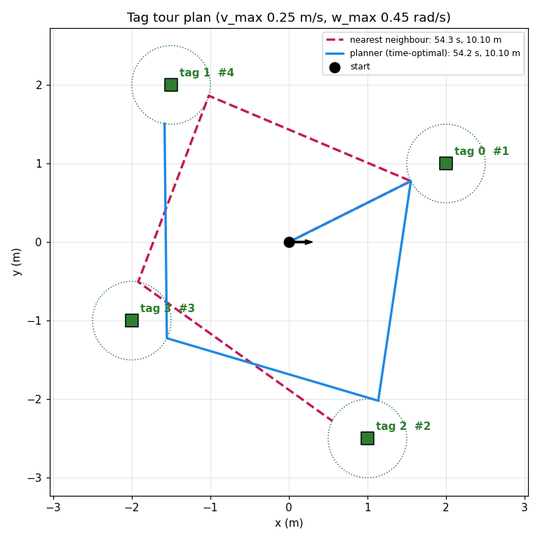

# ตัววางเส้นทาง AprilTag (แยกจากหุ่น)

ตัววางลำดับการไปหาแท็กของ AprilTag mission แยกออกมาให้รันเดี่ยวได้
ใช้แค่ Python มาตรฐาน **ไม่ต้องมี ROS** และไม่ต้องต่อหุ่น
(ตัวโปรแกรมตัวอย่างใช้ `matplotlib` วาดกราฟ)

| ไฟล์ | หน้าที่ |
|---|---|
| `tour_planner.py` | **อัลกอริทึม** copy มาจาก [golf_ball](https://github.com/AkanaNDE/golf_ball) `src/golf_bot_tags/golf_bot_tags/tour_planner.py` (เหมือนกันทุกบรรทัด) |
| `plan_demo.py` | โปรแกรมตัวอย่าง: วางแผน, พิมพ์รายละเอียดแต่ละช่วงทาง, เทียบกับวิธีอื่น, วาดกราฟ |

## ลองรัน
```bash
python3 plan_demo.py
python3 plan_demo.py --tags "2,1 -1.5,2 1,-2.5 -2,-1" --start 0,0,0
python3 plan_demo.py --tags "1,0 2,0 2,1 0,2 -1,1" --w 0.45 --plot plan.png
```
- `--tags`: ตำแหน่งแท็ก `"x,y x,y ..."` หน่วยเมตร
- `--start`: `x,y,มุมหัน(องศา)` ของหุ่น
- `--v`: ความเร็ววิ่ง m/s (`v_max`)
- `--w`: ความเร็วหมุน rad/s (`w_max`)
- `--standoff`: ระยะหยุดก่อนถึงแท็ก m
- `--overhead`: วินาทีต่อช่วงทาง

ผลของตัวอย่าง 4 แท็ก (`python3 plan_demo.py`): เส้นสีน้ำเงินคือลำดับที่ตัววางแผนเลือก
เส้นประสีชมพูคือวิธีไปแท็กใกล้สุดก่อน (nearest neighbour)



## หลักการ
**1. โมเดลเวลาของแต่ละช่วงทาง: "หมุนอยู่กับที่ แล้ววิ่งตรง"**
```
เวลา = |มุมที่ต้องหมุน| / w_max  +  ระยะวิ่ง / v_max  +  leg_overhead
```
- จุดหมายของแต่ละแท็กคือจุดที่อยู่ก่อนถึงแท็ก `standoff` เมตร บนเส้นที่หุ่นวิ่งเข้าหา
- มุมที่ต้องหมุนขึ้นกับทิศที่หุ่นมาถึงแท็กก่อนหน้า ต้นทุนของช่วง i → k จึงขึ้นกับแท็ก 3 ตัว `(p, i, k)`
  - p = แท็กที่มาก่อน
  - i = แท็กที่อยู่ตอนนี้
  - k = แท็กถัดไป

**2. หาลำดับที่เวลารวมน้อยที่สุด**
- ถ้ามี ≤ `exact_limit` แท็ก ใช้ **Held-Karp (dynamic programming)**
  - สถานะ = `(เซตแท็กที่ไปแล้ว, แท็กก่อนหน้า, แท็กปัจจุบัน)`
  - เก็บไว้แค่ทางที่เร็วที่สุดของแต่ละสถานะ ได้คำตอบดีที่สุดแน่นอนตามโมเดลนี้
  - เวลาคำนวณประมาณ O(2ⁿ · n³)
- ถ้าเกิน ใช้ **cheapest insertion + 2-opt / or-opt**
  - แทรกแท็กทีละอันในตำแหน่งที่เพิ่มเวลาน้อยที่สุด แล้วสลับลำดับจนเร็วขึ้นไม่ได้อีก
  - เร็ว แต่ไม่การันตีว่าดีที่สุด
- ไม่กลับจุดเริ่มต้น (open tour)

## ใช้ในโค้ดของตัวเอง
```python
from tour_planner import MotionModel, plan_tour, evaluate

model = MotionModel(v_max=0.25, w_max=0.45, standoff=0.5, leg_overhead=0.5)
tags = [(2.0, 1.0), (-1.5, 2.0), (1.0, -2.5), (-2.0, -1.0)]
tour = plan_tour(start=(0.0, 0.0), start_heading=0.0, tags=tags, model=model, exact_limit=10)

print(tour.order, tour.time, tour.distance, tour.method)   # [0, 2, 3, 1] 54.2 10.1 ...
for leg in tour.legs:   # tag, start, stop, heading, turn, distance, time
    print(leg.tag, leg.stop, leg.turn, leg.time)

evaluate([0, 1, 3, 2], (0, 0), 0.0, tags, model).time    # เวลาของลำดับที่กำหนดเอง
```

## AprilTag mission เรียกใช้ตรงไหน
ใน `tag_mission.py`:
- `replan()` ถูกเรียก**หลังสแกนเสร็จ**, **ทุกครั้งที่ถึงแท็ก**, และ**ตอนข้ามแท็ก**
- วางแผนจากตำแหน่งและทิศจริงของหุ่นตอนนั้น กับแท็กที่ยังเหลือ
- แล้ว**ไปแค่แท็กแรก**ของแผน

```python
def replan(self, reason):
    tags = {i: p for i, p in self.tag_map.tags().items()
            if i not in self.visited and i not in self.missed}
    if not tags:
        self.finish()
        return
    self.ids = list(tags.keys())
    self.positions = [tags[i] for i in self.ids]
    self.tour = plan_tour((self.pose[0], self.pose[1]), self.pose[2], self.positions,
                          self.model, self.p['exact_limit'])
    ...
    self.start_leg()

def start_leg(self):
    leg = self.tour.legs[0]
    self.target = self.ids[leg.tag]
    self.leg_budget = self.p['leg_timeout_factor'] * leg.time + 10.0   # เกินนี้ = ข้ามแท็ก
    self.start_align(f'-> tag {self.target}')
```
ค่า `MotionModel` มาจาก `tag_mission.yaml`: `v_max`, `w_max`, `standoff`, `leg_overhead`, `exact_limit`

## ข้อจำกัดของโมเดล
- **ไม่นับเวลาที่หุ่นเสียไปจริง:** การหยุดมองยืนยัน, การวิ่งเข้าไปทีละช่วง 0.4 m, เวลารอที่แท็ก (dwell)
  - เวลาจริงจึงมากกว่าที่ประเมินประมาณ 1.5–2 เท่า (ในภารกิจจำลองประเมินไว้ 48.9 วินาที ใช้จริง 91.7 วินาที)
  - ลำดับที่เลือกส่วนใหญ่ยังถูก เพราะทุกลำดับโดนเวลาเพิ่มคล้าย ๆ กัน
- **`w_max` ใน yaml ตั้งไว้ 0.8** แต่การหมุนจริงถูกจำกัดไว้ประมาณ 0.45 rad/s (เพื่อไม่ให้ภาพเบลอ) ตัวอย่างนี้ใช้ 0.45 เป็นค่าเริ่มต้น
- **ไม่รู้จักสิ่งกีดขวาง:** วิ่งเป็นเส้นตรงระหว่างแท็กเสมอ
